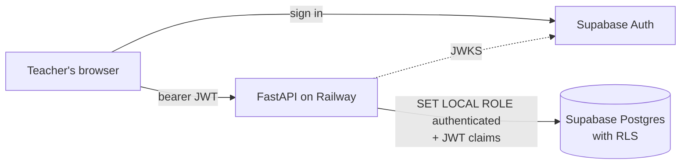

# Case study: Gradebook

A teacher gradebook: a FastAPI + Postgres API with Row Level Security, and a
Next.js dashboard with a spreadsheet-style grade grid. The interesting parts
are the grading math and making "teachers only ever see their own data" true
at more than one layer.

## The problem

Gradebooks look simple, but a few things make them tricky:

- **Weighted categories.** Tests count 40%, homework 35%. A category with
  nothing graded yet can't count as 0, or every student fails in week one.
- **Excused work** has to disappear from both the numerator and the denominator.
- **"Drop the lowest N"** is a common policy, and the obvious way to do it
  is wrong.
- **Teachers think in spreadsheets.** They paste columns of scores, expect
  arrow keys to work, and will import a roster exported from some other system.
- **It's student data.** A bug that shows one teacher another's roster is
  the worst failure the product can have.

## Architecture

The browser uses Supabase only to sign in. Every data request goes to the
API with the teacher's access token. The API verifies the token (asymmetric
keys through JWKS, or a legacy shared secret), then, inside **each database
transaction**, switches to Postgres's `authenticated` role and sets the
token's claims. That is the same mechanism Supabase's own REST layer uses, so
`auth.uid()` is the caller and the RLS policies in the migration apply to the
API's queries. Both settings are transaction-local, so a pooled connection
can't carry one teacher's identity into the next request.

## Key decisions

### Ownership is enforced twice, and tested from the outside

RLS is the backstop. The API also filters every query by the owner, and
returns **404, never 403**, for another teacher's rows, so ids don't leak.
Three kinds of tests keep both layers honest:

- An **isolation suite** calls every route that takes an id as the wrong
  teacher and expects a 404, with the owner's data unchanged. It also fails
  if someone adds a route without adding it to the suite.
- **RLS tests on real Postgres** use deliberately *unfiltered* raw SQL, so
  only the policies stand between teachers. They also check that grades can't
  be written for students who aren't enrolled.
- A **pre-deploy check** runs before every Railway deploy and cancels it if
  RLS is off on any table, if a policy is open to `anon`, if the role
  bypasses RLS, or if a stranger's token can see any row. These are
  misconfigurations where everything still *works*, which is why they need
  checking.

### Optimal drop-lowest, solved exactly

Dropping the N lowest *percentages* isn't what helps a student most when
assignments have different point values:

| Scores | Drop the lowest % (9/20) | Drop the 50/100 instead |
|---|---|---|
| 9/10, 50/100, 9/20 | 59/110 = **53.6%** | 18/30 = **60.0%** |

Choosing which k items to keep so that `Σearned / Σpossible` is as large as
possible is a fractional programming problem. The engine uses **Dinkelbach's
method**:

1. Guess a ratio q.
2. For that q, find the k items with the largest `earned − q·possible`, by
   sorting.
3. If that sum is above zero, a better ratio exists: jump to that subset's
   ratio and repeat.
4. When the sum hits zero, q is optimal.

Each step strictly improves q, so it terminates, usually in two or three
iterations. A randomized test compares it with brute force over every subset
in 300 cases.

### Exact arithmetic, and explaining the result

All grade math uses Python's `Fraction`. There's no float drift, ties resolve
the same way every time (the earlier assignment is kept), and `0.1 + 0.2`
weights behave. Floats appear only in the response.

When a category is empty, its weight is redistributed, so the engine
reports each category's **effective weight**: Tests (40%) actually counts
for 53% of the grade while Quizzes (25%) has nothing graded. The student
report shows that, along with whether each assignment was counted, dropped,
excused or ungraded. A grade is only as trustworthy as it is explainable.

### Assignment statistics that mean something

Missing work is **left out** of the stats by default: a class mean dragged
down by assignments never turned in says more about effort than about
understanding. One toggle counts it as 0. The standard deviation describes
the whole class, not a sample of a bigger one. The histogram puts a perfect
score in the top bin and gives extra credit its own open-ended bin, instead
of quietly capping scores at 100%.

### CSV that survives contact with real files

- **Roster import** accepts the header variations real exports use ("Student
  Name", "E-mail", separate first and last names), handles both UTF-8 and the
  Windows-1252 encoding that Excel on Windows saves by default, and is
  **all or nothing**: one bad row rejects the file with every problem listed
  by line, so a teacher fixes everything in one pass.
- **Re-importing is safe:** rows match existing students by email.
- **A dry run** gives the dashboard a preview step before anything is saved.
- **Export** escapes cells that a spreadsheet would run as a formula (`=`,
  `+`, `-`, `@`), so a student named `=HYPERLINK(...)` can't run anything on
  the teacher's machine. The exported file is also a valid roster, so last
  term's gradebook can set up next term's course.

### A grid that behaves like a spreadsheet

The dashboard's grid supports arrow keys, Tab and Enter, typing to replace a
cell, and pasting rectangular blocks from Sheets or Excel. A paste becomes
one bulk upsert per assignment, and if any pasted cell is invalid, nothing is
saved. Edits appear immediately but are saved **in order**, so fast typing
can't land out of sequence. The computed grades always come from the server,
so the dashboard never has its own copy of the grading rules.

The front end's TypeScript types are **generated from the API's OpenAPI
schema**, and CI fails if they're out of date, so the two halves can't drift.

## Testing

| Layer | What | How many |
|---|---|---|
| Grade engine and stats | rules, edge cases, optimal drops vs. brute force, stats vs. Python's `statistics` | ~400 |
| API | every resource, validation, isolation across teachers, CSV, query counts, scripts | ~160 |
| Postgres | RLS with unfiltered SQL, the full API under RLS, the pre-deploy check against 4 misconfigurations | 12 |
| Dashboard unit | cell parsing, keyboard movement, paste planning | 53 |
| End to end | a teacher's first day in a real browser against the real API | 3 |

A few habits mattered more than the counts:

- **Checking that tests can fail.** For the safety-critical code (ownership
  filters, CSV escaping, dry-run rollback, the no-N+1 guard), the code was
  deliberately broken to confirm the tests went red, and then restored.
- **No N+1 queries.** A test counts SQL statements for a 2-student and a
  15-student class and requires them to match (7 either way).
- **End to end, with almost nothing faked.** The Playwright test starts the
  real API on a fresh database and a production Next.js build. Only Supabase
  sign-in is stubbed, and the stub returns a properly signed token that the
  API verifies as usual. It caught a real bug: the course page jumped from
  Setup to Gradebook as soon as the first category was added.

## Deployment

The API ships as a Docker image to Railway, and the dashboard to Vercel. The
pre-deploy RLS check runs before every release. A seeding script builds the
demo through the deployed API with a real teacher login, so the demo data
passes the same validation and RLS as real use, and a successful seed doubles
as a smoke test. See [deploy.md](deploy.md).

## Trade-offs and what's next

- **Late work isn't penalized.** It's recorded and shown, and a per-category
  late penalty is the natural next rule.
- **No grade history.** An audit log of who changed which grade, and when,
  is what a school would ask for first.
- **One letter scale.** Each course should be able to set its own cutoffs;
  the engine already takes the scale as a parameter.
- **Two teachers can't share a course.** RLS makes adding co-teachers a
  policy change rather than a rewrite: own a course, or be listed on it.
- **Excused work counts as a whole assignment.** Partial credit for an
  excused part of an assignment would need a new kind of grade entry.
